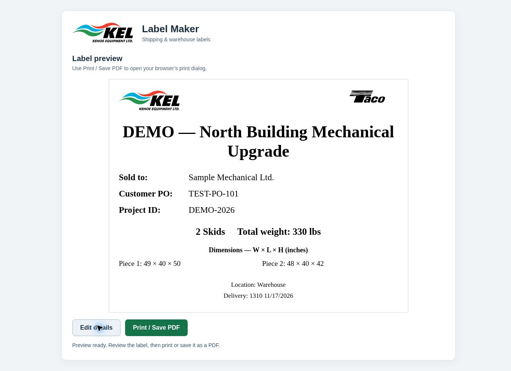

[English](README.md) | [Українською](README.uk.md)

# KEL Label Maker

A buildless browser app for shipping and warehouse labels at Kehoe Equipment.



## Use

1. Open **Product of** and tick one or more manufacturers. Every selected logo appears on the label; untick a manufacturer to remove its logo.
2. Use **+ Add package type** to add **Skid**, **Crate**, or **Box** rows, each with its own whole quantity. For example, 1 Skid + 1 Crate + 2 Boxes automatically gives **Total pieces: 4**. Blank rows are optional. The combined shipment is limited to 100 pieces. Repeated types are combined in the printed summary.
3. Enter each package’s dimensions as **W × L × H in inches**. Dimensions stay with their package row when quantities are changed or temporarily cleared. Removing a package row removes its own dimensions and preserves the other rows’ values.
4. Select **Generate Label** to review the label. Use **Edit details** to return without losing your entries.
5. Select **Print / Save PDF**, then choose a printer or “Save as PDF” in the browser’s print dialog. Ctrl/Cmd+P also renders the current entries.

Blank optional fields are omitted from the label. All selected manufacturer logos are loaded before the Print button opens the dialog. Long labels can continue onto additional pages instead of being clipped; the final pagination depends on the printer, paper size, and print settings. For clean output, turn off browser headers and footers.

Entries are kept in memory while the page is open. Reloading or closing the page clears them. The app has no backend, account, or cloud storage.

## Develop

```sh
git clone https://github.com/Bodia0210/lablemaker.git
cd lablemaker
python3 -m http.server 8000
```

Open <http://localhost:8000>. No package installation or build is required.

```sh
node --check scripts/main.js
git diff --check
```

For changes to label behavior, check generation, editing, mixed packaging, automatic totals, quantity changes (including clearing and restoring), package removal, optional fields, multiple manufacturer logos, and printing in a browser. Check long content with the target printer and paper size.

## Files

- `index.html` — accessible editor and label preview.
- `scripts/main.js` — dimension rows, validation, preview rendering, and print preparation.
- `styles/styles.css` — responsive form, shared label styles, and print rules.
- `svg/` — existing manufacturer and KEL logo assets.
