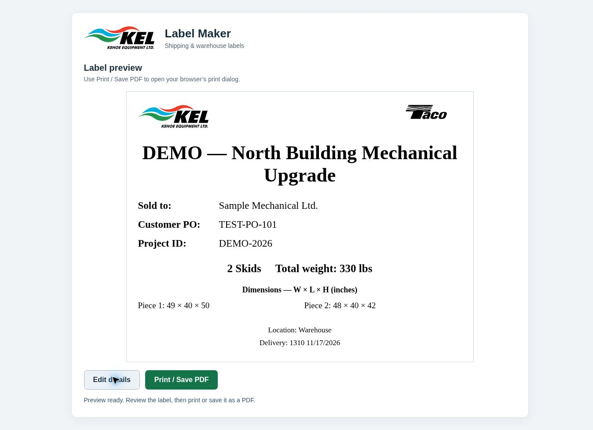

[English](README.md) | [Українською](README.uk.md)

# KEL Label Maker

Вебдодаток для транспортних і складських етикеток Kehoe Equipment. Працює в браузері без встановлення залежностей і збирання.



## Використання

1. За потреби виберіть виробника та введіть дані проєкту й клієнта.
2. Вкажіть цілу кількість місць (1–100), тип упаковки та загальну вагу у фунтах. Невідомі значення можна залишити порожніми.
3. Для кожного місця введіть розміри **W × L × H у дюймах**. Зміна або тимчасове очищення кількості зберігає введені розміри в поточному сеансі.
4. Натисніть **Generate Label**, щоб переглянути етикетку. **Edit details** повертає до редагування зі збереженням введених даних.
5. Натисніть **Print / Save PDF** і виберіть принтер або «Зберегти як PDF» у діалозі браузера. Ctrl/Cmd+P також формує етикетку з поточних даних.

Порожні необов’язкові поля не друкуються. Кнопка друку чекає завантаження логотипів. Довгі етикетки можуть переходити на наступні сторінки без обрізання; остаточне розбиття залежить від принтера, формату паперу й налаштувань. Для чистої етикетки вимкніть колонтитули браузера.

Дані зберігаються в пам’яті, поки сторінку відкрито. Оновлення або закриття сторінки їх очищає. Сервер, обліковий запис і хмарне сховище не використовуються.

## Локальний запуск

```sh
git clone https://github.com/Bodia0210/lablemaker.git
cd lablemaker
python3 -m http.server 8000
```

Відкрийте <http://localhost:8000>.

## Перевірка змін

```sh
node --check scripts/main.js
git diff --check
```

У браузері перевіряйте створення й редагування етикетки, зміну кількості (зокрема очищення та відновлення), необов’язкові поля, логотипи та друк. Довгий текст перевіряйте з потрібним принтером і форматом паперу.

## Структура

- `index.html` — форма з підписами полів і попередній перегляд.
- `scripts/main.js` — розміри місць, перевірка даних, формування етикетки й підготовка друку.
- `styles/styles.css` — адаптивна форма, оформлення етикетки та правила друку.
- `svg/` — наявні логотипи виробників і KEL.
